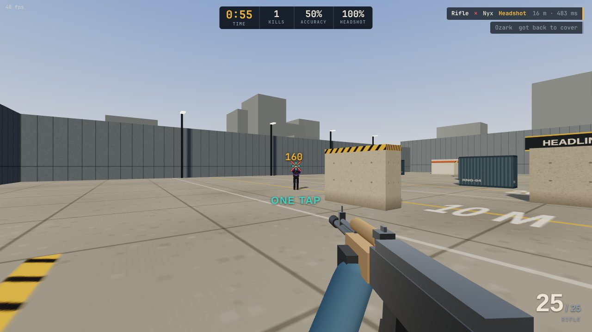

# Headline Aim Range

A browser aim trainer for tactical shooters. Agents walk out from behind cover at 9 to 60 m. Every agent has the same health pool and hitbox, and you shoot them with a rifle or revolver tuned to Valorant's Vandal and Sheriff stat sheets. Optional flash drills throw two kinds of flashes at you so you can practise turning away and swinging back.



## Run it

It is a static site with no build step. Serve the folder over HTTP: ES modules do not load from `file://`.

```bash
npm start                 # uses npx serve on http://localhost:5173
# or
python3 -m http.server 5173
```

Open the URL in Chrome, Edge or Firefox and click **Start session**. The click locks the mouse. Three.js loads from jsDelivr, so the first load needs a network connection.

To host it, any static host works. For GitHub Pages: Settings → Pages → deploy from the branch and folder that contain `index.html`.

## Controls

| Input | Action |
| --- | --- |
| Left mouse | Fire (hold for full auto) |
| Right mouse | Zoom 1.25× (rifle) |
| R | Reload |
| 1 / 2 | Rifle / revolver |
| Esc | Pause |

Sensitivity uses Valorant's scale (0.07° per mouse count) and the field of view is 103° horizontal, so your in-game sensitivity carries over. The settings panel also shows your cm/360 for a given DPI. Raw mouse input (`unadjustedMovement`) is requested when the browser supports it.

## What is modelled

### Health

Every agent has **100 health** plus the shield you pick: none (100), light (125) or heavy (150, the default). Shields absorb damage first. All eight agents share one hitbox (head, body including arms, and legs). They differ only in looks.

### Weapons

| | Rifle (Vandal stats) | Revolver (Sheriff stats) |
| --- | --- | --- |
| Head / body / legs | 160 / 40 / 34 at any range | 159 / 55 / 46 up to 30 m, then 145 / 50 / 42 |
| Fire rate | 9.75 rounds/s (−10% zoomed) | 4 rounds/s |
| Magazine | 25 | 6 |
| Reload | 2.5 s | 2.25 s |
| First-shot spread | 0.25° (0.16° zoomed) | 0.25° |

Against 150 HP, the rifle kills with 1 headshot, 4 body shots or 5 leg shots. The revolver one-taps the head inside 30 m but needs two headshots beyond that. The settings panel recalculates shots-to-kill when you change shields.

**Recoil.** The rifle spray climbs gently for the first three bullets, kicks up hard for bullets 4–9, then sways left and right along the top. Spread stays tight for the first few rounds and then opens up. It recovers if you pause briefly, so 2–3 round bursts stay accurate. Each revolver shot kicks about 2.4°, and spamming it blooms fast. Recoil and recovery are hand-tuned to feel like the reference guns. They are not extracted data.

### Agents

Agents spawn behind cover and do one of four things:

- **Peek:** step out and hold the angle.
- **Strafe:** step out and jiggle left and right.
- **Cross:** walk or run from one piece of cover to the next.
- **Swing:** run out wide right after a flash pops.

Running agents move at 6.75 m/s and you can hear their footsteps. Walking agents are silent.

Peek spots are computed from the cover layout at load time. The game sweeps a line behind each row of cover and finds where an agent goes from fully hidden to fully visible. Health bars only appear while you have line of sight.

### Flashes

| | Curve flare (modelled on Phoenix's Curveball) | Hawk flash (modelled on Skye's Guiding Light) |
| --- | --- | --- |
| Path | Arcs out around a corner | Glides out from cover toward you |
| Cue | Whoosh on throw | Screech on launch, then a rising screech 0.55 s before the pop |
| Time to pop | 0.65 s | 0.75–1.25 s of flight + 0.55 s windup |
| Full blind if you look at it | 1.1 s, then a 0.55 s fade | 1.75 s, then a 0.75 s fade |

How much you get flashed depends on the angle between your view and the pop. Up to 42° off-centre is a full flash. The effect fades out by 95°, so turning roughly 90° away dodges completely. Cover between you and the pop also blocks it. With **"An agent swings out right after each pop"** on, an agent runs out from where the flash came from about 0.1–0.4 s after the pop, so you have to turn back and take the fight. **Flash drill only** removes every other agent.

Timings are approximations of the abilities, not data pulled from the game.

### Stats

The end-of-session report shows:

- **Shooting:** kills, accuracy and headshot rate.
- **Speed:** time from an agent becoming visible to your first hit and to the kill.
- **Breakdown:** where your hits landed, one-tap kills, agents that got back to cover, best streak and average kill distance.
- **Flashes:** dodged, partial and full flashes, plus total time blind.

Personal bests are saved per settings combination in `localStorage`.

## Project layout

```
index.html        menu, HUD and result screens (all CSS inline)
src/config.js     weapon stats, health, flash timings, roster, defaults
src/world.js      range geometry, cover, ray tests, peek-spot generation
src/agents.js     agent models, shared hitboxes, movement plans, animation
src/weapon.js     viewmodels, fire rate, recoil pattern, spread, reload
src/flashes.js    curve flare and hawk flash paths and visuals
src/effects.js    sparks, tracers, decals, flash pop glow
src/audio.js      synthesized sounds with HRTF positional audio
src/hud.js        crosshair, hit markers, damage numbers, kill feed, health bars
src/input.js      pointer lock and raw mouse input
src/game.js       simulation: spawning, shot resolution, flash dodging, stats
src/main.js       settings UI, screens and the frame loop
```

There are no audio or model files. Everything is generated at runtime with three.js and WebAudio.

## Moving it into its own repository

This folder is self-contained. To split it into a new repository with its history:

```bash
git subtree split --prefix headline-aim-trainer -b headline-aim-trainer
git push git@github.com:<you>/headline-aim-trainer.git headline-aim-trainer:main
```

## Notes

This is an independent fan project and is not affiliated with Riot Games. It uses no Riot assets. The agents, guns and abilities are original designs. Only the published damage, fire-rate, magazine and health numbers are matched.
